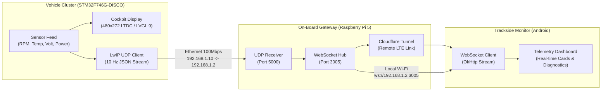

# KOU Racing - FSAE Telemetry System

[Türkçe Dokümantasyon](README.tr.md)

Real-time telemetry and data acquisition system designed for the Formula Student Electric racing vehicle. The system integrates an on-vehicle digital instrument cluster (STM32), an Ethernet-based gateway (Raspberry Pi), and a trackside monitoring application (Android).

---

## Architecture Overview

The system pipeline consists of three interconnected layers:



---

## Subsystems

### 1. Vehicle Cluster Firmware (`Telemetry/`)
* **Target Hardware:** STM32F746G-DISCO (ARM Cortex-M7 @ 216 MHz, 1 MB Flash, 320 KB SRAM, 64 Mbit external SDRAM).
* **Display Pipeline:**
  * 4.3" 480x272 LCD driven via LTDC (Layer 0, 16-bit RGB565 format at `0xC0000000` framebuffer base).
  * LVGL 9 graphics library utilizing direct framebuffer flush.
  * FMC SDRAM initialization sequence configured with 100 MHz memory clock (CAS latency 3).
* **RTOS & Networking:**
  * FreeRTOS real-time kernel managing UI rendering and network dispatch tasks.
  * LwIP TCP/IP stack running on RMII Ethernet PHY with static IP configuration (`192.168.1.10`).
  * Telemetry frames dispatched at 10 Hz over UDP port 5000.
* **Driver Interface:**
  * Dual-screen support: Primary cockpit dashboard (RPM LEDs, traction control indicators, speed, temperatures, battery status) and secondary detailed diagnostics screen toggled via onboard user button (PI11).

### 2. Trackside Android Application (`TelemetryAndroid/`)
* **Platform:** Native Android (Kotlin, Min SDK 24, Target SDK 34).
* **Networking:** OkHttp WebSocket client supporting two operational modes:
  * **Local Network Mode:** Direct connection (`ws://<GATEWAY_IP>:3005`) for pit-lane Wi-Fi monitoring.
  * **Tunnel Mode:** Remote connection over cellular LTE via Cloudflare Zero Trust Tunnel endpoint (`wss://...`).
* **Authentication:** Team token challenge handshake on connection establishment prior to streaming packet reception.
* **Telemetry Decoder:** Binary packet unpacker parsing 28-byte little-endian IEEE-754 payload buffers directly into structured telemetry states.

### 3. Gateway & Tools
* **`rpi_gateway_auth.js`:** Node.js WebSocket authentication middleware handling team credential verification and unauthenticated client timeouts.
* **`udp_test_sender.py`:** Python testing utility that generates synthetic Formula Student telemetry feeds over UDP socket for standalone firmware/app verification without physical hardware.

---

## Telemetry Packet Specification

### UDP Datagram (STM32 -> Gateway)
STM32 broadcasts JSON-encoded packets over UDP port 5000 at 10 Hz:

```json
{
  "rpm": 5420,
  "speed": 82,
  "motor_temp": 68,
  "battery_voltage": 358.4,
  "throttle": 0.72,
  "brake": 0.00,
  "bat_temp": 42,
  "inv_temp": 48,
  "oil_temp": 78,
  "wtr_temp": 62,
  "tire_left": 58,
  "tire_right": 61,
  "power_watts": 185,
  "bat_percent": 74,
  "regen_percent": 12,
  "tcs_percent": 5,
  "mode": "ENDR",
  "ready": "true",
  "fault": "false",
  "traction_control": "false"
}
```

### Binary WebSocket Frame (Gateway -> Android)
High-frequency binary payloads streamed to mobile clients are packed in 28-byte little-endian buffers:

| Offset (Bytes) | Field | Type | Scale / Range |
|---|---|---|---|
| `0 - 3` | Sequence ID | uint32_t | Monotonic packet counter |
| `4 - 7` | Motor RPM | float (IEEE-754) | 0 - 10000 RPM |
| `8 - 11` | Vehicle Speed | float (IEEE-754) | 0 - 150 km/h |
| `12 - 15` | Motor Temperature | float (IEEE-754) | °C |
| `16 - 19` | Battery Voltage | float (IEEE-754) | 300.0 - 400.0 V |
| `20 - 23` | Throttle Input | float (IEEE-754) | 0.0 - 1.0 (or 0 - 100%) |
| `24 - 27` | Fault Status | uint32_t | 0 = OK, 1 = Fault |

---

## Repository Structure

```text
├── README.md                      # System documentation
├── LICENSE                        # MIT License
├── .gitignore                     # Build and environment exclusions
├── rpi_gateway_auth.js            # Gateway authentication middleware
├── udp_test_sender.py             # Telemetry simulation script
├── Telemetry_Final_Project.pdf    # Project documentation and specifications
├── Telemetry/                     # STM32CubeIDE project (C / FreeRTOS / LVGL)
│   ├── Core/                      # Application sources and HAL initialization
│   ├── Drivers/                   # CMSIS and STM32F7xx HAL drivers
│   ├── LWIP/                      # LwIP network configuration and target drivers
│   ├── Middlewares/               # FreeRTOS, LwIP, and LVGL library
│   └── Telemetry.ioc              # STM32CubeMX device configuration
└── TelemetryAndroid/              # Android Studio project (Kotlin)
    └── app/src/main/
        ├── java/com/kouracing/    # Socket manager, telemetry models, activity
        └── res/                   # Layouts, colors, themes, resources
```

---

## Build and Setup Guide

### Firmware (STM32)
1. Open **STM32CubeIDE** and import `Telemetry/` as an Existing Project into Workspace.
2. Ensure GCC toolchain is configured for ARM Cortex-M7 with hardware FPU (`-mfpu=fpv5-sp-d16 -mfloat-abi=hard`).
3. Connect the STM32F746G-DISCO board via ST-LINK USB port (CN14).
4. Build the target (`Project -> Build Project`) and flash via standard ST-LINK debugger configuration.

### Android Application
1. Open **Android Studio** and open the `TelemetryAndroid/` directory.
2. Let Gradle sync project dependencies (OkHttp, AndroidX, Material3).
3. Connect an Android device or launch an emulator with Network Access enabled.
4. Run the `:app` configuration.

### Telemetry Simulator
To test the cluster and mobile client without vehicle sensor inputs:
```bash
python udp_test_sender.py
```

---

## License

This project is licensed under the MIT License. See the [LICENSE](LICENSE) file for details.
