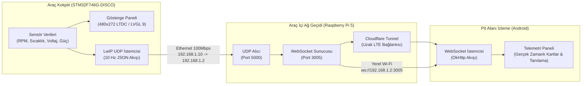

# KOU Racing - FSAE Telemetri Sistemi

[🇬🇧 English](README.md) | [🇹🇷 Türkçe](README.tr.md)

Formula Student Electric yarış aracı için geliştirilmiş gerçek zamanlı telemetri ve veri toplama sistemi. Sistem; araç içi dijital gösterge paneli (STM32), Ethernet tabanlı ağ geçidi (Raspberry Pi) ve pit alanı izleme uygulamasından (Android) oluşur.

---

## Mimari Genel Bakış

Sistem veri akışı üç ana katmandan meydana gelir:



---

## Alt Sistemler

### 1. Araç Kokpit Yazılımı (`Telemetry/`)
* **Hedef Donanım:** STM32F746G-DISCO (ARM Cortex-M7 @ 216 MHz, 1 MB Flash, 320 KB SRAM, 64 Mbit harici SDRAM).
* **Ekran ve Grafik:**
  * 4.3 inç 480x272 LCD ekran, LTDC birimi üzerinden doğrudan `0xC0000000` SDRAM taban adresindeki 16-bit RGB565 tamponuyla sürülür.
  * Grafik arayüzü LVGL 9 kütüphanesi ile doğrudan çizim tamponu (draw buffer) kullanılarak çizilir.
  * FMC SDRAM başlatma dizisi 100 MHz bellek saat hızı ve CAS latency 3 değerine göre yapılandırılmıştır.
* **İşletim Sistemi ve Ağ:**
  * FreeRTOS çekirdeği arayüz çizimi ve ağ paket gönderim görevlerini yönetir.
  * LwIP TCP/IP yığını RMII Ethernet PHY üzerinde statik IP (`192.168.1.10`) ile çalışır.
  * Telemetri verileri saniyede 10 kez (10 Hz) UDP port 5000 üzerinden yayınlanır.
* **Sürücü Arayüzü:**
  * Çift ekran desteği: Ana kokpit ekranı (RPM LED göstergeleri, çekiş kontrol bildirimleri, hız, sıcaklıklar, batarya durumu) ve detaylı tanılama ekranı. Ekran geçişi kart üzerindeki mavi kullanıcı butonu (PI11) ile yapılır.

### 2. Pit Alanı Android Uygulaması (`TelemetryAndroid/`)
* **Platform:** Yerel Android (Kotlin, Min SDK 24, Target SDK 34).
* **Ağ Katmanı:** OkHttp WebSocket kütüphanesi iki farklı bağlantı modunu destekler:
  * **Yerel Ağ Modu:** Pit alanındaki Wi-Fi üzerinden doğrudan bağlantı (`ws://<GATEWAY_IP>:3005`).
  * **Tünel Modu:** Hücresel LTE şebekesi üzerinden Cloudflare Zero Trust tünel uç noktasına uzaktan bağlantı (`wss://...`).
* **Kimlik Doğrulama:** Veri akışı başlamadan önce soket üzerinden takım şifresi doğrulama el sıkışması yapılır.
* **Veri Ayrıştırıcı:** Ağ geçidinden gelen 28 baytlık little-endian IEEE-754 ikili paketleri doğrudan telemetri nesnelerine dönüştürür.

### 3. Ağ Geçidi ve Yardımcı Araçlar
* **`rpi_gateway_auth.js`:** Raspberry Pi üzerinde çalışan, takım şifresini denetleyen ve doğrulanmamış bağlantıları zaman aşımına uğratan Node.js WebSocket ara yazılımı.
* **`udp_test_sender.py`:** Fiziksel donanım bağlı değilken yazılımı ve mobil uygulamayı test etmek için UDP soketine simüle Formula Student telemetri verisi gönderen Python betiği.

---

## Telemetri Paket Biçimi

### UDP Paketi (STM32 -> Ağ Geçidi)
STM32, UDP port 5000 üzerinden 10 Hz frekansla JSON formatında veri yayınlar:

```json
{
  "rpm": 5420,
  "speed": 82,
  "motor_temp": 68,
  "battery_voltage": 358.4,
  "throttle": 0.72,
  "brake": 0.00,
  "bat_temp": 42,
  "inv_temp": 48,
  "oil_temp": 78,
  "wtr_temp": 62,
  "tire_left": 58,
  "tire_right": 61,
  "power_watts": 185,
  "bat_percent": 74,
  "regen_percent": 12,
  "tcs_percent": 5,
  "mode": "ENDR",
  "ready": "true",
  "fault": "false",
  "traction_control": "false"
}
```

### İkili WebSocket Çerçevesi (Ağ Geçidi -> Android)
Mobil istemciye iletilen yüksek frekanslı paketler 28 baytlık little-endian ikili tampon olarak iletilir:

| Konum (Bayt) | Alan | Veri Tipi | Ölçek / Aralık |
|---|---|---|---|
| `0 - 3` | Paket Sıra No | uint32_t | Artan sayaç değeri |
| `4 - 7` | Motor Devri (RPM) | float (IEEE-754) | 0 - 10000 RPM |
| `8 - 11` | Araç Hızı | float (IEEE-754) | 0 - 150 km/h |
| `12 - 15` | Motor Sıcaklığı | float (IEEE-754) | °C |
| `16 - 19` | Batarya Voltajı | float (IEEE-754) | 300.0 - 400.0 V |
| `20 - 23` | Gaz Kelebeği Girdisi | float (IEEE-754) | 0.0 - 1.0 (veya %0 - %100) |
| `24 - 27` | Arıza Durumu | uint32_t | 0 = Normal, 1 = Arıza |

---

## Dizin Yapısı

```text
├── README.md                      # İngilizce sistem dokümantasyonu
├── README.tr.md                   # Türkçe sistem dokümantasyonu
├── LICENSE                        # MIT Lisansı
├── .gitignore                     # Derleme ve ortam dışlama kuralları
├── rpi_gateway_auth.js            # Ağ geçidi doğrulama ara yazılımı
├── udp_test_sender.py             # Telemetri simülasyon betiği
├── Telemetry_Final_Project.pdf    # Proje raporu ve şartname
├── Telemetry/                     # STM32CubeIDE projesi (C / FreeRTOS / LVGL)
│   ├── Core/                      # Uygulama kaynak kodları ve HAL sürücüleri
│   ├── Drivers/                   # CMSIS ve STM32F7xx HAL kütüphaneleri
│   ├── LWIP/                      # LwIP ağ yapılandırması ve hedef sürücüler
│   ├── Middlewares/               # FreeRTOS, LwIP ve LVGL kütüphanesi
│   └── Telemetry.ioc              # STM32CubeMX donanım yapılandırma dosyası
└── TelemetryAndroid/              # Android Studio projesi (Kotlin)
    └── app/src/main/
        ├── java/com/kouracing/    # Soket yöneticisi, veri modelleri, arayüz kodu
        └── res/                   # Ekran düzenleri, renkler, temalar, kaynaklar
```

---

## Kurulum ve Çalıştırma Kılavuzu

### Gömülü Yazılım (STM32)
1. **STM32CubeIDE** uygulamasını açın ve `Telemetry/` klasörünü mevcut proje olarak içeri aktarın.
2. GCC derleyici ayarlarının ARM Cortex-M7 donanımsal kayan nokta birimine (`-mfpu=fpv5-sp-d16 -mfloat-abi=hard`) ayarlandığından emin olun.
3. STM32F746G-DISCO kartını ST-LINK USB portu (CN14) üzerinden bilgisayara bağlayın.
4. Projeyi derleyin (`Project -> Build Project`) ve ST-LINK hata ayıklayıcısı ile karta yükleyin.

### Mobil Uygulama (Android)
1. **Android Studio** uygulamasını açın ve `TelemetryAndroid/` dizinini seçin.
2. Gradle bağımlılıklarının (OkHttp, AndroidX, Material3) eşitlenmesini bekleyin.
3. Bir Android cihaz bağlayın veya ağ erişimi olan bir emülatör başlatın.
4. `:app` konfigürasyonunu çalıştırın.

### Telemetri Simülatörü
Sistemi fiziksel araç veya sensörler olmadan test etmek için:
```bash
python udp_test_sender.py
```

---

## Lisans

Bu proje MIT Lisansı kapsamında lisanslanmıştır. Ayrıntılar için [LICENSE](LICENSE) dosyasına bakabilirsiniz.
